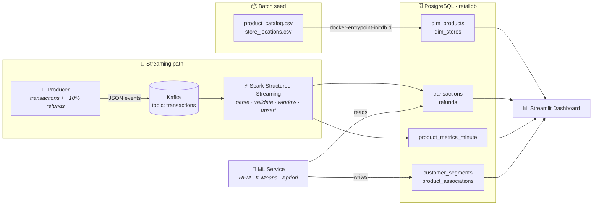
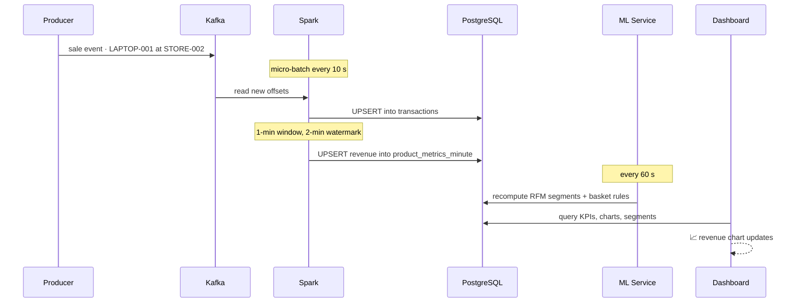
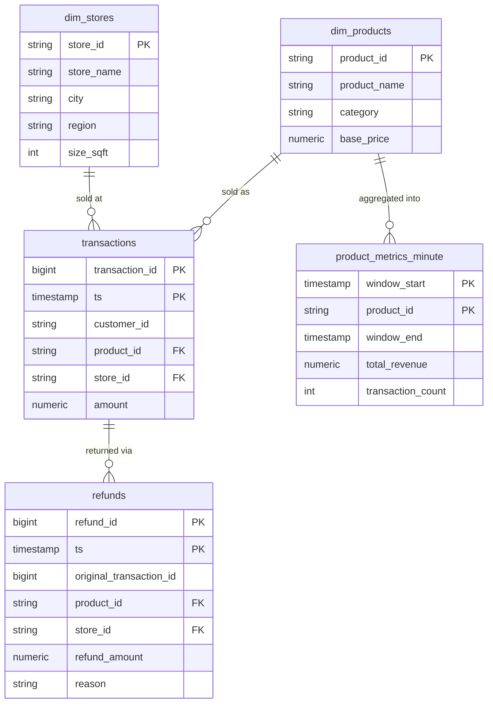

<div align="center">

# 🛒 Real-time Retail Analytics Pipeline

### Every sale, streamed, aggregated and understood in seconds

*Kafka → Spark Structured Streaming → PostgreSQL star schema → ML customer intelligence → live Streamlit dashboard. One `docker compose up` runs all of it.*


[What it does](#-what-it-does) •
[Architecture](#%EF%B8%8F-architecture) •
[Quick start](#-quick-start) •
[Data model](#%EF%B8%8F-data-model) •
[Streaming](#-the-streaming-engine) •
[ML](#-the-intelligence-layer) •
[Dashboard](#-the-dashboard)

</div>

---

## 🎬 What it does

Picture a retail chain with stores in **Riyadh, Jeddah and Dammam**. Every second, laptops, phones and monitors sell, and now and then a customer returns something.

This pipeline turns that stream of events into answers:

- 💰 **How much are we making right now?** Revenue per product, per minute, updated continuously.
- 🏬 **Which regions perform best, and why are customers returning products?**
- 👥 **Who are our best customers?** RFM segmentation sorts them into *Champions*, *Loyal Customers*, *At Risk* and more.
- 🧺 **What do people buy together?** Market-basket rules power "customers also bought" recommendations.

## ✨ Highlights

| | |
|---|---|
| 🐳 **One command** | Seven containers (Zookeeper, Kafka, Postgres, Spark, producer, ML service, dashboard) start with one `docker compose up` |
| 🌊 **True streaming** | Spark Structured Streaming with micro-batch triggers every 10–15 s |
| ⏱️ **Event-time windows** | 1-minute tumbling windows with a 2-minute watermark for late events |
| 🔁 **Idempotent writes** | `INSERT … ON CONFLICT` upserts plus Spark checkpoints, so replays never double-count |
| ⭐ **Star schema** | Product and store dimensions around transaction and refund fact tables |
| 🧠 **ML daemon** | RFM scoring, K-Means clustering and Apriori association rules, refreshed every 60 s |
| 📊 **Live dashboard** | Streamlit with live filters, three tabs, and KPIs that update on their own |

---

## 🏗️ Architecture



Component deep dive: **[docs/architecture.md](docs/architecture.md)**

### A single sale, start to finish



---

## 🚀 Quick start

### Prerequisites

- Docker Desktop (4 GB+ RAM recommended)

### Run it

```bash
git clone https://github.com/CapCoder0/realtime-retail-pipeline.git
cd realtime-retail-pipeline

cp .env.example .env      # optional: tweak producer speed, ML settings
docker compose up --build
```

Give Spark about 30–60 seconds to download its Kafka and Postgres connectors on first start, then open:

### 👉 **http://localhost:8501**

| Service | Address | Purpose |
|---|---|---|
| 📊 Dashboard | http://localhost:8501 | Streamlit UI |
| 🗄️ PostgreSQL | `localhost:5433` | `postgres` / `postgres`, database `retaildb` |
| 📬 Kafka | `localhost:19092` | Broker (topic `transactions`) |
| 🦓 Zookeeper | `localhost:2181` | Kafka coordination |

> ⚠️ The database credentials are local development defaults. Change them before exposing anything.

### Poke at the data

```bash
docker exec -it postgres psql -U postgres -d retaildb

retaildb=# SELECT product_id, SUM(total_revenue) FROM product_metrics_minute GROUP BY 1 ORDER BY 2 DESC;
retaildb=# SELECT rfm_segment, COUNT(*) FROM customer_segments GROUP BY 1;
retaildb=# SELECT * FROM product_associations ORDER BY lift DESC LIMIT 5;
```

### Stop

```bash
docker compose down          # stop
docker compose down -v       # stop and wipe data
```

---

## 🗂️ Data model



ML output tables: **`customer_segments`** (recency, frequency, monetary, R/F/M scores, `rfm_segment` and `cluster_id` per customer) and **`product_associations`** (antecedent → consequent, with support, confidence and lift).

Full DDL: [db/init/01_schema.sql](db/init/01_schema.sql) · Seed data: [db/data/](db/data/)

---

## ⚡ The streaming engine

`services/spark/src/streaming_job.py` runs three streaming queries in parallel:

| Query | Trigger | What it writes |
|---|---|---|
| **Transactions** | every 10 s | Parsed, validated sales → `transactions` |
| **Refunds** | every 10 s | Refund events → `refunds` |
| **Minute metrics** | every 15 s | Revenue and transaction count per product per 1-minute window → `product_metrics_minute` |

**Why it holds up:**

- **Event-time windows.** Aggregation uses the event's own timestamp, not the time it arrived.
- **Watermarking.** Events up to 2 minutes late are still counted in the right window. Anything later is dropped, so state doesn't grow without limit.
- **Checkpointing.** Kafka offsets and window state survive restarts.
- **Upserts.** Writes go through `foreachBatch` with `ON CONFLICT DO UPDATE`, so a replayed batch overwrites its rows instead of duplicating them.

---

## 🧠 The intelligence layer

The ML service (`services/ml_service/`) wakes every `ML_POLL_SECONDS` (default 60) and recomputes two models over the full history:

### 👥 RFM customer segmentation

| Step | |
|---|---|
| **R**ecency | Days since the customer's last purchase |
| **F**requency | Number of purchases |
| **M**onetary | Total spend |
| Scoring | Each dimension scored 1–5 by quintile, then mapped to a named segment |
| Clustering | K-Means (`ML_N_CLUSTERS`, default 4) on standardized R, F and M values |

Segments: 🏆 **Champions** · 💎 **Loyal Customers** · 🌱 **Potential Loyalists** · 🆕 **New Customers** · 👀 **Need Attention** · ⚠️ **At Risk** · 💤 **Hibernating**

### 🧺 Market basket analysis

Purchases are grouped into baskets, then **Apriori** (`mlxtend`) finds frequent itemsets and produces association rules with **support**, **confidence** and **lift**. The output reads like *"customers who buy a laptop also buy a wireless mouse."*

---

## 📊 The dashboard

A Streamlit app (`services/dashboard/`) with a **live filter sidebar** and three tabs:

| Tab | What you see |
|---|---|
| 📈 **Sales Activity & Revenue Trajectory** | Live revenue, transaction and refund KPIs, minute-level revenue trend, top products, category split |
| 🗺️ **Regional Performance & Return Logistics** | Store and region comparison, refund reasons and refund volume |
| 🧠 **Customer Intelligence & Market Basket** | RFM cluster distribution, segment table, product recommendation rules |

---

## ⚙️ Configuration

All settings are environment variables (see [`.env.example`](.env.example)):

| Variable | Default | Meaning |
|---|---|---|
| `PRODUCER_SLEEP_SECONDS` | `1.0` | Delay between generated events |
| `KAFKA_TOPIC` | `transactions` | Topic for sales and refunds |
| `ML_POLL_SECONDS` | `60` | How often the ML service recomputes |
| `ML_N_CLUSTERS` | `4` | K-Means cluster count |
| `ML_MIN_TRANSACTIONS` | `10` | Minimum data before ML runs |
| `CHECKPOINT_DIR` | `./spark-checkpoints` | Spark state location |

---

## 📁 Project structure

```
realtime-retail-pipeline/
├── db/
│   ├── data/                 # product + store seed CSVs
│   └── init/                 # schema + seed SQL (auto-run by Postgres)
├── services/
│   ├── producer/             # synthetic transaction + refund generator → Kafka
│   ├── spark/                # Structured Streaming job + submit script
│   ├── ml_service/           # RFM, K-Means, Apriori daemon
│   └── dashboard/            # Streamlit app
├── docs/architecture.md
├── docker-compose.yml
├── .env.example
└── CONTRIBUTING.md
```

## 🛠️ Troubleshooting

| Symptom | Fix |
|---|---|
| Dashboard is empty | Wait about a minute. Spark waits 30 s for Kafka and Postgres, then downloads its connectors |
| `spark` container restarts | Check `docker compose logs spark`. Kafka may not be ready yet, and it will retry |
| No customer segments | The ML service needs `ML_MIN_TRANSACTIONS` sales first, so give it a few minutes |
| Port 5433 / 8501 already in use | Change the host port in `docker-compose.yml` |
| Apple Silicon | Kafka and Zookeeper images already set `platform: linux/amd64` |

## 🗺️ Roadmap

- [ ] Real-time anomaly alerts on minute revenue (z-score)
- [ ] Schema Registry with Avro events
- [ ] dbt models on top of the star schema
- [ ] Grafana and Prometheus for pipeline health
- [ ] Kubernetes deployment

## 🤝 Contributing

Pull requests are welcome. See **[CONTRIBUTING.md](CONTRIBUTING.md)** for the workflow.

<div align="center">

**From checkout counter to insight in under a minute. ⚡**

</div>
